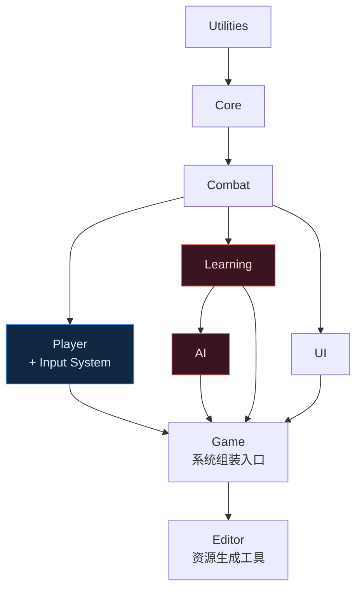

# 试玩地址：https://learnedyet.github.io/LearntY-Boss/

# 自适应boss竞技场

**一款 Boss 会研究玩家习惯的单场遭遇战动作游戏。** 玩家在一座竞技场中与一个 Boss 对战。它会统计你的攻击、闪避、站位和慌乱反应，形成行为画像，再逐步调整策略来克制这些习惯，整个过程都不会读取你的输入。取胜的关键是察觉它的变化，并相应改变自己的打法。


这是用 Unity 6 制作的《只狼》式弹反对决，资源全部由代码生成，包括场景和预制体。项目的首要约束是 Boss 不能作弊：

> **优先级最高的规则：Boss 绝不作弊。** 它不能读取玩家输入、输入缓冲、体力、冷却时间或无敌帧，只能根据人类对手从画面中能够观察到的信息作出反应，而且必须经过合理的感知延迟。程序集依赖图负责约束这条边界：AI 和学习程序集不能引用提供这些作弊信息的玩家代码；测试会在边界被突破时使构建失败。详见 [架构说明](Docs/ARCHITECTURE.md)。

### 防止 Boss 作弊的依赖边界



**AI** 和 **Learning** 程序集没有指向 Player 或 Input System 的引用，这条缺失的依赖就是隔离边界。Boss 可以获取的玩家状态都经过受感知范围约束、带延迟的通道，因此佯攻可以奏效，对决也能保持公平。

### 反过来利用它的适应

Boss 研究玩家只是机制的一半。每一种反制策略都会给出可观察的提示，而它对策略的过度投入也会成为玩家可以利用的弱点：

1. 它识别你的攻击、站位和防守习惯，例如偏向格挡还是用移动避开，然后持续施压。提示可能是：“它不再忌惮你的防守。”
2. 你改变习惯，让它已经投入的攻击落空。
3. **它失去平衡。** 全力挥出的攻击落空后，Boss 会踉跄，暂时无法攻击，并承受更高的架势伤害；投入越深，失衡越严重。
4. 你抓住破绽，打破它的架势并完成处决。

原本压制你的反制策略，就这样变成了它暴露破绽的原因。适应只改变数值，不改变规则：Boss 不会获得此前没有的招式。尚未积累足够行为证据时，适应机制保持休眠，让开局对战清晰可读。

---

## 项目状态

**七个开发阶段均已完成，并进行了进一步的表现打磨；游戏流程覆盖标题界面到完整战斗。**

玩家可以移动、冲刺、连击、治疗、弹反、积累专注值，也会受到硬直。Boss 观察玩家，并通过四个阶段逐步升级，最后进入拼死一搏的 **Last Stand** 阶段；阶段切换带有明显的表现效果。它会组合连招、使用无法格挡的危险攻击和改变场地的招式，并逐步针对玩家反复使用的行为形成应对，包括依赖格挡的程度和弹反时机的精确度。识破反制后，玩家可以让 Boss 失衡并获得进攻机会。游戏还包含标题界面、开战提示、决胜时刻慢动作、战后行为分析报告、挑战修正项，以及可用的设置菜单。

| 阶段 | 范围 | 状态 |
|------|------|------|
| 1 | 架构、接口契约、工具、测试 | ✅ 完成 |
| 2 | 玩家控制器：移动、冲刺、体力 | ✅ 完成 |
| 3 | 战斗：攻击判定、连击、硬直、打击停顿 | ✅ 完成 |
| 4 | Boss AI：状态机、攻击、阶段 | ✅ 完成 |
| 5 | 学习系统：行为画像和适应 | ✅ 完成 |
| 6 | UI、设置、存档系统 | ✅ 完成 |
| 7 | 表现打磨：后处理、音频、调参 | ✅ 完成 |

### 表现打磨：让基础几何体具有生命感

- **程序化角色动画。** 胶囊体会蓄势、突进、完成挥击、受击后退和死亡倒地，全部由代码驱动，无需骨骼。重击和弹反时，镜头会短暂推进。
- **游戏流程表现。** 生成标题场景，战斗开始前显示开战提示，决定胜负的一击带有慢动作。
- **Boss 阶段升级。** 阶段切换包含咆哮、冲击波、逐步增强的光环和短暂无敌；后续阶段会将攻击串成连招。
- **设置和操作引导。** 音量、屏幕震动和辅助功能选项即时生效并持久保存，可从标题和暂停菜单进入。屏幕显示操作说明，并支持按键重绑定：点击操作项，再按下新按键即可保存；重置操作会恢复默认绑定。
- **自适应音频。** 配乐由三个程序生成的循环层叠加：背景基底、紧张层和节奏脉冲。它们随着 Boss 升级逐渐淡入，让音乐与战况同步增强。
- **会响应战况的竞技场。** 灯光和环境氛围随 Boss 阶段从冷色、均匀照明转为炽热的红色，让场景本身也传达战斗变化。
- **画面反馈。** 玩家濒死时画面发红并降低饱和度；受击时震动，精准弹反时镜头产生冲击效果。减少闪烁设置可以关闭这些效果。
- **不同武器。** 三种武器有不同的招式：长剑使用均衡的三段连击，大剑使用缓慢而沉重的两段攻击，能量刃使用快速的四段连击；各自的防守方式也不同，见下文。
- **支持接入正式美术资源。** 基础几何体已经能够完整承载玩法，项目预留了可独立配置、允许空值的接入点，可用于接入暗黑幻想角色、武器、技能特效和环境资源。详见 [美术资源接入指南](Docs/ART_INTEGRATION.md)。

### 玩法深度

- **战后报告。** 战斗结束时，Boss 展示它对玩家的判断：有把握的习惯及其置信程度、已形成的反制策略，以及玩家的弹反次数、完美闪避和剩余生命。这样，“它在研究你”就能直接体现在界面上，而不只存在于 F1 调试面板。
- **挑战修正项。** 在标题界面选择并保存：快速学习使适应速度翻倍，禁止治疗，脆弱，以及训练模式。训练模式持续显示行为判断面板，并避免玩家被最后一击击杀，方便练习观察 Boss。战后报告会列出启用的挑战。
- **专注和强化特殊攻击。** 弹反和完美闪避积累专注值；蓄满后，下一次特殊攻击会变成更强、带紫色光效的版本，奖励精准防守。硬直会清空专注值。
- **拼死阶段。** Boss 生命低于 15% 时进入 **Last Stand**，使用相同的咆哮和光效切换，但拥有最完整的招式、更短的恢复时间和更快的学习速度，竞技场也达到最强的视觉效果。每个阶段都有更常使用的标志性攻击，形成可辨认的威胁。

### 空间控制和行为判断

- **场地危险区域。** Boss 的砸地和冲击波会在地面留下持续危险区域。伤害较低，但会占据空间并累积，尤其是在 Last Stand 阶段。玩家必须管理走位空间，不能始终自由绕圈换血；这些区域只威胁玩家，Boss 不受自己火焰的伤害。
- **无法格挡的危险攻击。** 部分 Boss 攻击会闪烁红光，并完全无视格挡。玩家必须闪避，这让防守选择除了弹反时机之外，还需要判断该格挡还是闪避。
- **阶段切换招式。** 切换阶段时，Boss 会释放有预警、无法格挡、覆盖全场的冲击波，并在地面留下灼烧区域，玩家需要先活过这段攻击。
- **处决。** 打破 Boss 架势后，反击会成为强力处决；如果这一击结束战斗，世界会进入明显的电影式慢动作。
- **决意和孤注一掷。** 战斗持续进行时 Boss 会积累决意，玩家闪过它的攻击时积累更快。发光增强会显示积累进度；蓄满后，它消耗决意释放标志性的孤注一掷攻击，即危险的场地冲击波。闪避后循环重新开始。这个机制回应战斗的实际进程，不读取玩家输入。

按 **F1** 打开调试面板。HUD 展示正在发生的事情，调试面板展示 Boss 相信的事情，方便调整遭遇战。

### 运行方式

打开项目和 `Assets/_Project/Scenes/MainMenu.unity`，点击 Play；构建版本也会从标题界面启动。如果生成的资源缺失，执行 `Adaptive Boss Arena/Setup/Run Full Setup`。

### 操作

| 操作 | 键盘 / 鼠标 | 手柄 |
|------|-------------|------|
| 移动 | WASD 或方向键 | 左摇杆 |
| 冲刺 | 空格 | B / Circle |
| 轻攻击 | 鼠标左键 | X / Square |
| 重攻击 | 鼠标右键 | Y / Triangle |
| **格挡 / 弹反** | **左 Shift** | 左肩键 |
| 特殊攻击 | Q | 右肩键 |
| 治疗 | R | 方向键上 |
| 切换武器 | V | 方向键右 |
| 开启 / 关闭锁定 | Tab | — |
| 切换镜头 | C | — |
| 调试面板 | F1 | — |
| 暂停 | Escape | Start |

### 弹反机制

防守是战斗的核心。抬起防守后的前 **0.15 秒**内受到攻击会触发弹反：完全抵消伤害，并削减 Boss 架势。晚于这个时机则只是格挡：玩家能够抵御攻击，但会受到少量伤害并消耗自己的架势。

弹反能主动压制对手；持续格挡则会消耗自己的架势直至被打破。弹反消耗的是对手的架势，清空 Boss 架势条后会出现反击机会。

如果玩家始终以可预测的节奏弹反，Boss 最终会学会佯攻：先给出真实的攻击预警，然后取消攻击。应对方法是改变固定节奏。

### 三种武器

| 武器 | 操作特点 | 防守特点 |
|------|----------|----------|
| 长剑 | 均衡 | 0.20 秒的较短弹反窗口，造成较高架势伤害 |
| 大剑 | 挥击更慢、消耗更高 | **不能招架**，改为霸体：投入后的挥击不会被来袭攻击打断，但恢复阶段仍可能被打出硬直 |
| 能量刃 | 挥击更快、消耗更低 | 0.28 秒的宽松防守窗口，架势消耗较慢，可以持续防御连续攻击 |

偏好的武器本身也是 Boss 统计的习惯。三种防守方式由有单元测试覆盖的小型决策逻辑 `Combat/DefenceResolver.cs` 实施，武器的取舍有实际规则支撑。

在恢复窗口内再次输入轻攻击可以衔接三段连击。攻击即将命中时冲刺会触发完美闪避，并提供短暂的慢动作反击机会。

---

## Boss 如何学习

Boss 通过能够合理观察到的行为建立画像：攻击频率、翻滚方向、偏好的交战距离、是否在闪避结束后立刻进攻、治疗频率，以及完美闪避是否总发生在相同的帧。它每隔几秒重新计算画像，并偶尔针对证据最充分的习惯形成应对。反制策略带有独立提示。频繁重攻击会让它开始招架；过于随意地治疗会招来突进；完全规律的闪避则会诱使它用佯攻打乱时机。

游玩时可以留意以下特点：

- **它不会读取输入。** 程序集依赖图约束这条边界，详见 [架构说明](Docs/ARCHITECTURE.md)。
- **它的反应有延迟。** 用于决策的观察数据约有 140 ms 的滞后，因此佯攻可以奏效。
- **它会告知变化。** 每次适应都会显示提示；没有提示时，说明它还没有形成适应。
- **它会犯错。** 即使存在完美玩家能够抓住的破绽，它有时也会错过惩罚机会。

可以故意使用重复打法，例如连续重攻击或每次都向左翻滚，观察调试面板中相应习惯的置信度在反制出现之前逐渐上升。

---

## 配置项目

### 1. 安装 Unity

项目面向 **Unity 6.3 LTS（6000.3.x）**。

1. 安装 [Unity Hub](https://unity.com/download)。
2. 在 Hub 中进入 **Installs → Install Editor**，选择 **Unity 6.3 LTS**。
3. 在编辑器中运行不需要额外模块；制作独立 Windows 构建时添加 **Windows Build Support (IL2CPP)**。

建议使用 `ProjectSettings/ProjectVersion.txt` 记录的具体编辑器补丁版本打开项目。

### 2. 打开项目

在 Unity Hub 中选择 **Add → Add project from disk**，选择项目目录。首次导入需要解析包依赖并生成 Library，可能需要几分钟。

导入后 Console 应没有编译错误；如果出现错误，应作为问题排查。

### 3. 首次初始化

项目提供代码生成的图层、物理规则和场景配置。在菜单栏选择：

**Adaptive Boss Arena → Setup → Run Full Setup**

初始化流程按依赖顺序执行：

| 步骤 | 作用 |
|------|------|
| Configure Project | 创建图层和标签、配置碰撞矩阵、将物理频率固定为 60 Hz |
| Configure Render Pipeline | 创建并指定 URP 资源，避免缺少渲染管线时出现洋红色材质 |
| Generate Default Assets | 创建攻击、策略、配置和事件通道资源 |
| Retune Generated Assets | 将调参数值重新写入已有资源并保留 GUID；修改 `DefaultAssetGenerator` 数值后可执行此步骤，否则新值只作用于新建资源 |
| Generate Input Actions | 创建键盘、鼠标和手柄绑定 |
| Generate Player Prefab | 从基础几何体构建玩家并连接引用 |
| Generate Boss Prefab | 从基础几何体构建 Boss 并连接引用 |
| Build Arena Scene | 生成竞技场、灯光、镜头和两个战斗角色 |

预制体依赖配置和输入绑定，场景依赖预制体，因此通常执行 **Run Full Setup**。各步骤允许重新运行；生成器通常保留已有资源，避免覆盖手工调整。

### 4. 验证

- 打开 `Assets/_Project/Scenes/Arena.unity` 并点击 **Play**。原型中的蓝色胶囊体是玩家，较大的红色胶囊体是 Boss；它应靠近、预警并攻击。按 **F1** 查看调试面板。
- 打开 **Window → General → Test Runner → EditMode → Run All**。所有测试应通过，包括验证 AI 无法访问玩家输入的 `ArchitectureFirewallTests`。

### 不打开交互式编辑器的验证方式

初始化和测试也支持无界面批处理，适合持续集成。`Application.isBatchMode` 为 true 时，它们会跳过确认对话框。

编译项目并记录错误：

```bash
"C:\Program Files\Unity\Hub\Editor\6000.3.20f1\Editor\Unity.exe" -batchmode -quit -nographics -projectPath . -logFile compile.log
```

重新生成资源、预制体和场景：

```bash
"C:\Program Files\Unity\Hub\Editor\6000.3.20f1\Editor\Unity.exe" -batchmode -quit -nographics -projectPath . -logFile setup.log -executeMethod AdaptiveBossArena.Editor.ProjectSetupRunner.RunFullSetup
```

运行全部编辑模式测试，输出 JUnit 风格的结果：

```bash
"C:\Program Files\Unity\Hub\Editor\6000.3.20f1\Editor\Unity.exe" -batchmode -nographics -projectPath . -runTests -testPlatform EditMode -testResults test-results.xml -logFile tests.log
```

### 复现一场战斗

`--- Managers ---` 对象上的 `GameBootstrapper` 有 **Random Seed** 字段。设为零时，每次运行使用新的种子；设为固定值时，随机决策包括后续阶段的反制选择都可以复现。实际使用的种子会在启动时输出到 Console。

---

## 仓库结构

```text
Assets/_Project/Scripts/
├── Utilities/    纯算法：环形缓冲区、移动平均、直方图
├── Core/         接口、数据类型、服务；只依赖 Utilities
├── Combat/       攻击定义和命中结算
├── Player/       玩家角色；处理输入的玩法程序集
├── Learning/     行为分析和反制策略选择
├── AI/           Boss 状态机和决策
├── UI/           HUD 和菜单
├── Managers/     系统组装入口和场景管理
└── Editor/       初始化工具和架构校验

Assets/Tests/EditMode/               无需进入运行模式的测试
Assets/_Project/ScriptableObjects/   生成的配置资源
Docs/ARCHITECTURE.md                 系统如何组合及其设计原因
```

## 修改项目时的约定

修改前阅读 [开发约定](Docs/DEVELOPMENT.md)。主要规则：

- 只能由 `TimeService` 写入 `Time.timeScale`。
- 不调用 `UnityEngine.Random`，使用注入的 `IRandomProvider`。
- 不允许 AI 或 Learning 程序集引用 Player。
- 场景和资源由代码生成。
